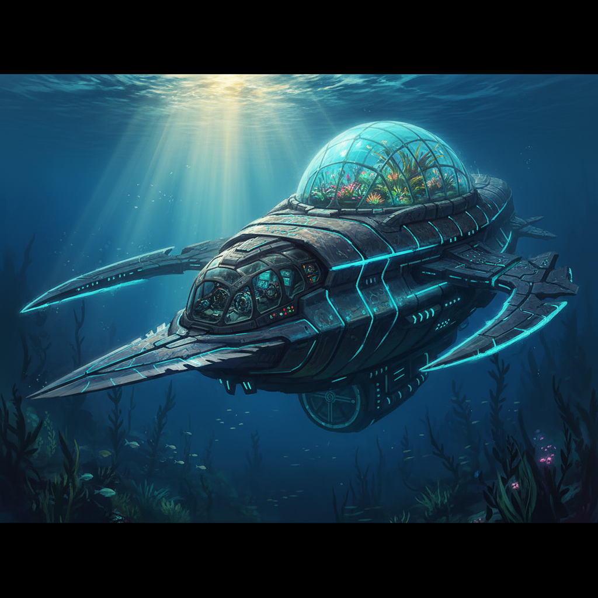

**Status:** early playable blockout is OUT. The sub is real, buildable and spawnable in game (see the v0.1.1-alpha release and INSTALL.md). The five-deck interior and blade damage system come next.

# The Voider

> A gargantuan Precursor razor-class submarine for **Subnautica** (the original game).

The Voider is a razor-type combat submarine built by the Precursors. It is gargantuan, it has five full walkable decks, and the razor blades along its hull cut through leviathan-class creatures in a single pass. A one-tap for the leviathan.

**No custom 3D models are planned.** The hull is generated in code (procedural geometry) and the interior reuses the game's own Precursor tech, so this mod never needs a modeling artist.

## Status
Design + code scaffold. Very early, work in progress.

A first **blockout mesh v1** of the hull exists: [models/voider_blockout_v1.obj](models/voider_blockout_v1.obj), generated entirely in code (no modeling software), with a [preview render](models/preview_v1.png). It carries the layout from the concept art: blade-wrapped hull, greenhouse dome, bridge glass at the bow.

| | |
|---|---|
| Game | Subnautica 1 |
| Framework | [VehicleFramework](https://github.com/PrimeSonic/VehicleFramework) (custom vehicles) |
| Mod loader | BepInEx + Nautilus (the modern standard; QModManager is retired) |
| Hull | Procedural, generated in code |
| Interior | In-game Precursor tech assets |

## Documents
- [The Voider design document](docs/THE_VOIDER_DESIGN.md) - identity, specs, the five-deck plan, the razor blades, and the SeaTruck comparison
- Deck plan, roadmap, and install notes live inside the design doc.

## Roadmap
1. Design doc + code scaffold (this repo)
2. VehicleFramework skeleton that spawns the sub
3. Procedural hull generated in code
4. Walkable five-deck interior
5. Razor-blade damage system
6. Sounds, cockpit UI, balancing, in-game testing

## License
MIT, see [LICENSE](LICENSE).
